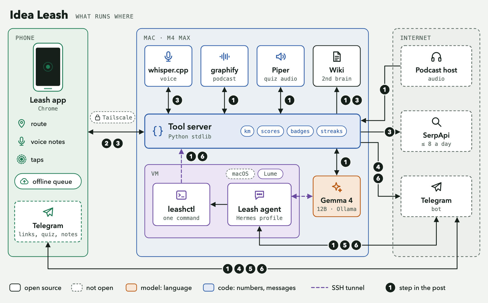

# Idea Leash

> Listen to a podcast on a walk, say your ideas out loud, and answer a five-question quiz afterwards with one tap. A local open model keeps the notes. The phone stays in your pocket.

**Challenge:** Hacktoberfest Open-Source AI Challenge: Week 1, Touch Grass (DEV event 79) · **Window:** Oct 5 18:00 → Oct 12 06:59 UTC · **Tag:** `#hf26challenge` · **Post:** [Idea Leash: an open-source walk buddy with a local model for a brain](https://dev.to/santteegt/idea-leash-an-open-source-walk-buddy-with-a-local-model-for-a-brain-499n) (published 2026-10-11 23:30 local)

## What it does

1. **Before the walk.** You send a podcast or YouTube link to a Telegram bot. The Mac downloads the audio, transcribes it, writes verified notes into a markdown wiki (the "second brain") and prepares a quiz.
2. **During the walk.** A small web app on the phone records the walk (GPS track, time, distance) behind a black screen. A big button records a voice idea. You listen to the podcast in your usual player.
3. **After the walk.** The Mac sends a Telegram summary written by code: distance, time, your ideas, new medals, "the quiz is ready". You say "quiz me". Multiple-choice questions arrive as buttons. The last question asks you to connect an idea to something you saw on the walk.
4. **Medals** for kilometers, time with the dog, streaks, voice ideas and quiz results are computed by plain code, never by the model.

The model's jobs are language jobs: summaries, quiz questions, grading wording, replying. Distances, scores and medals are code. Every quiz question carries a verbatim quote, and a script checks that the quote exists in the transcript.

## Why open matters here

The agent's brain is **Gemma 4 12B** (Apache 2.0, 4-bit QAT build) served by **Ollama** on the author's Mac, driven by the **Hermes Agent** harness (MIT). Speech to text is **whisper.cpp** with Whisper large-v3-turbo. Nothing in the loop calls a hosted model.

What that bought, from the logs of the real run on 2026-10-09:

- **Voice and location stay on the Mac.** Voice notes are transcribed there, the GPS track is stored there, and the wiki is plain files the author owns. Ollama's request log (since 2026-10-08 23:41, tests included) holds 183 chat requests from the agent; no hosted model was configured or called.
- **Zero running cost.** No per-token bill for quizzes, notes or voice transcription. The only metered service is optional web search (SerpApi, free tier, capped at 8 searches a day in our own code).
- **Swappable parts.** The model is one name in a file. The speech model, the voice and the agent harness are each replaceable without touching the rest.
- **Grounding I can inspect.** Because the model is local and its output goes through a verifier, a bad quiz is caught by code. On three test transcripts the quiz skill with the verifier passed 27 of 27 checks, against 20 of 27 for a plain prompt.

What open did not give me: reliability. A 12B model drives tools unreliably (details under "Honest limits").

## Demo

Demo video (3 min 59 s): https://youtu.be/ikb7P_XMQAw, "a walkthrough on how I use the Leash app and its ambient agent to rest from work and touch grass by going out with my dog and/or exercising while maintaining a second brain with content learned and ideas". A fuller description for the video is in [docs/demo-video-description.md](docs/demo-video-description.md).



The three views of the phone app, rendered at phone width with real data, are in [docs/screens/](docs/screens/).

## Status of each part

| Part | Tested on | Result |
| --- | --- | --- |
| Podcast to notes and quiz | Mac, two real episodes (30.7 and 56.7 minutes) | 477 s and 1,090 s end to end; one quiz passed every check, the other kept verified quotes but failed length and answer-guessability checks (labelled `partial`) |
| Quiz in Telegram with buttons | real phone, one session | 5 questions answered, 5 of 6 |
| Voice notes through Telegram | real phone, three notes | all transcribed: one idea saved, one driving refusal, one misheard and resent |
| Walk app, screen on | real phone, one 35 minute walk | 3.15 km, tracked 2116 s of 2117 s |
| Walk app, screen off or app switched | real phone, two walks | **does not work**: a web page gets no GPS while hidden |
| Offline walk, queued upload when back online | real phone, one 19 minute dog walk with 3 voice notes | uploaded 30 s after reconnecting; Telegram message followed |
| Walk interruption and resume | desktop browser with fake GPS, then one real interruption on the phone (2026-10-11) | a 139 s gap in a dog walk was stated (143 s untracked), the walk continued and was saved; one occurrence |
| Activity and Badges views, 16 badges, bottom navigation | desktop browser at phone size, then the real phone | the author found the design and UX good; no layout issues reported |
| After-walk Telegram message | two real walks | arrived after the walk (confirmed by the author for the dog walk) |
| Grade and "podcast ready" messages sent by the Mac itself | unit tests with a fake Telegram, then one real quiz retake (2026-10-10) | grades delivered and the model stayed silent after each multiple choice answer; one quiz |
| Voice-requested web search | Telegram voice note (author, real phone); app-note path in a throwaway-server test with the real search service | works from Telegram; the app-note path is built and tested, not yet used on a real walk |
| Services restart after a crash | crash test by hand | server and tunnel back within 25 s; automatic login is on in the VM, but a real sleep cycle and a VM reboot are untested |

Numbers and methods for every line are in [docs/CHALLENGE-MEMORY.md](docs/CHALLENGE-MEMORY.md).

## Run it

Tested on one machine: Apple silicon Mac (M4 Max, 64 GB), macOS, with an Android phone. The full loop also needs a Telegram bot and Tailscale on the Mac and the phone. The Hermes agent runs in a Lume macOS VM; `agent/README.md` and `ops/README.md` cover that part. I have not re-run this whole sequence on a clean machine.

```bash
brew install uv ffmpeg                      # plus the Ollama app and `brew install lume` for the VM
cp .env.example .env                        # LEASH_UPLOAD_TOKEN: openssl rand -hex 24; add Telegram and SerpApi keys
uv sync

# speech to text: whisper.cpp with Metal, and the model
git clone --depth 1 --branch v1.9.5 https://github.com/ggml-org/whisper.cpp vendor/whisper.cpp
(cd vendor/whisper.cpp && ../../.venv/bin/cmake -B build && ../../.venv/bin/cmake --build build -j --config Release)
sh vendor/whisper.cpp/models/download-ggml-model.sh large-v3-turbo-q5_0
mkdir -p models/whisper && cp vendor/whisper.cpp/models/ggml-large-v3-turbo-q5_0.bin models/whisper/

# the voice that reads quiz questions aloud, and the language model
.venv/bin/python -m piper.download_voices en_US-lessac-medium --download-dir models/piper
ollama pull gemma4:12b-it-qat
ollama create leash-gemma4-12b -f agent/Modelfile.leash
```

Try the pipeline without Telegram or a phone:

```bash
PYTHONPATH=src .venv/bin/python -m leash ingest "<podcast or YouTube link>" --vault data/test-vault
for t in walks notify lookups; do PYTHONPATH=src .venv/bin/python tests/test_$t.py; done
```

Run the stack as services, publish the app on your tailnet and pair the phone:

```bash
ops/leash-stack install --vault "$PWD/data/test-vault"
ops/leash-stack gateway-install        # Hermes gateway service inside the VM
ops/leash-stack phone-serve && ops/leash-stack pair
ops/leash-stack status
```

## Stack

| Piece | What | License | Where it runs |
| --- | --- | --- | --- |
| Language model | Gemma 4 12B QAT through Ollama (derived alias `leash-gemma4-12b`, 64K context) | Apache 2.0 (as shown by `ollama show --license`) | Mac |
| Agent harness | Hermes Agent v0.21.6, one `leash` profile (`agent/`) | MIT | Lume macOS VM |
| Speech to text | whisper.cpp v1.9.5, Whisper large-v3-turbo q5_0 | MIT | Mac, Metal |
| Podcast transcription | graphify 0.9.80 with faster-whisper (CPU) | Apache 2.0 / MIT | Mac |
| Audio download | yt-dlp | Unlicense | Mac |
| Text to speech | Piper `en_US-lessac-medium`, run as a separate process | package GPL-3.0-or-later; check the voice's model card before redistributing it | Mac |
| Knowledge base | OKF wiki, built with the repo's `okf-wiki` skill conventions | n/a | Mac files |
| Tool server, quiz verifier, medals | `src/leash/` (Python standard library) | MIT (this project) | Mac |
| Phone app | `app/` (one HTML file, no framework) | MIT (this project) | Chrome on Android |

**Partner tech used:** Gemma (the agent, notes, quiz and grading model) and SerpApi (voice-requested web search, free tier). Nothing else from the partner list is used.

**Not open, and used:** Telegram (the chat channel), Tailscale (private network and HTTPS), SerpApi (search), YouTube (the audio source) and macOS inside the VM. Lume, which runs the VM, is MIT licensed. They carry messages, links and search queries; the model, the voice and the files do not leave the Mac except as described in the limits below.

## Layout

| Folder | Contents |
| --- | --- |
| `src/leash/` | ingest pipeline, quiz and verification, wiki writer, tool server, walks, medals, notifications |
| `skills/` | `podcast-quiz` (generate and grade, with its verifier) and `leash-tools` (how the agent calls the Mac) |
| `agent/` | the Hermes profile: `SOUL.md`, config, setup script |
| `app/` | the phone web app (three views, icon and badge sprites in `app/assets/`) |
| `ops/` | launchd services, tunnel, pairing, status |
| `phone-test/` | the first walk test page (kept for the record); its raw GPS tracks are not published |
| `docs/walk-tests/` | the four walk test reports (stats only) behind the "no GPS while hidden" finding |
| `tests/` | tests for walk statistics, medals, message text and search detection; `tests/fixtures/` holds anonymised copies of the real tracks |
| `scripts/` | skill installer, VM helpers and `make-fixtures.py` |
| `docs/CHALLENGE-MEMORY.md` | the dated log of decisions, measurements and failures |
| `docs/design-notes.md` | the design spec for the app (tokens, wireframes, copy), written with a design subagent |

## Honest limits

- **No background GPS.** On the test phone (Redmi Note 11, Chrome 154) a web page gets no GPS fixes while it is hidden, whether the screen is off or another app is in front. The app keeps the screen on behind a black cover; if it is interrupted it says how long it could not track and does not count distance across the gap. A native app could run a location service in the background; I did not build one.
- **One person, one phone, a handful of walks.** No claim about other phones, iOS or other users.
- **The 12B model relays results unreliably.** In a quiz on 2026-10-10 it told the author a wrong answer was right, although the tool had graded it correctly, and it said a quiz was ready when it was not fully checked. So the Mac now sends the grade of each answer and the "podcast ready" message to Telegram itself, from code; the model only asks the questions and answers questions. In one retake after that change the model stayed silent after all four multiple choice answers. The open question is still graded by the model, and its wording comes from the model.
- **The 12B model is not a reliable tool user.** It sometimes skips a command and describes it as done: on one phrasing, about one try in three returned search results it had not run. The server keeps a request log, tool replies carry receipts, and the quiz flow is driven by the server so the model only has to follow one instruction. Grading of the open question looked generous on one example; its accuracy is not measured.
- **Latency.** Most agent turns take 0.7 to 7 seconds. Three turns took 1 to 2.5 minutes for a reason I have not found.
- **Speech recognition makes mistakes**, especially names. A vocabulary hint helps; four seconds of silence is transcribed as "Thank you."
- **The podcast audio comes from YouTube through yt-dlp**, for personal processing, which conflicts with YouTube's terms of service. Audio and transcripts stay on the Mac and are not in this repository.
- **The Hermes gateway needs the Mac awake.** While the Mac sleeps the bot is offline.
- **A session under 5 minutes is not saved** as a walk (its voice notes are kept as ideas).
- **Voice notes in the app are ideas first.** Only a note that starts with an explicit search phrase ("search for…", "look up…") triggers a web search, after the walk, with the top three links in the Telegram message; the query goes to SerpApi. Anything else is only saved.
- **English only.**

## Credits and prior work

- Built with **Claude Code** (Anthropic) as the coding assistant; ideation and the app's icon, badge and layout design used subagents (the design work is in `docs/design-notes.md`). The agent sessions are summarized in the DEV post.
- The repo's `okf-wiki` skill (OKF conventions for the wiki) was committed on 2026-10-04, before the challenge window opened. It is prior work and is credited as such.
- `graphify` produced the transcripts through its video pipeline; the global graphify skill was updated by its own CLI during this work (disclosed in the memory log).
- Open-source projects used: Gemma (Google), Ollama, Hermes Agent (Nous Research), whisper.cpp and Whisper (OpenAI), yt-dlp, graphify, Piper (OHF-Voice / Rhasspy), Lume (Cua), segno, PyAV, faster-whisper.
- The weekend project in `../01-weekend-build-for-a-friend` is a different challenge entry; no code is shared.
- Author: Santiago Gonzalez (DEV: @santteegt). Solo entry, no teammates.
- Started inside the challenge window: the folder was scaffolded 2026-10-06 04:40 UTC (window opened 2026-10-05 18:00 UTC).
- Commits after the deadline: none so far (update this line if that changes).

## License

MIT, see [LICENSE](LICENSE). Third-party components keep their own licenses.
