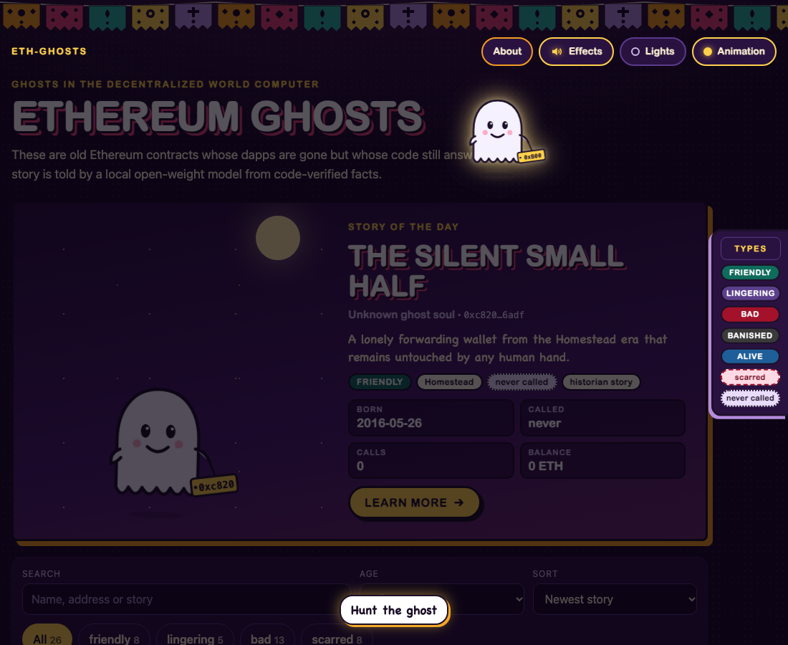

<!-- DRAFT by Lane I, 2026-10-29. Not staged, not published. Image URLs are placeholders (docs/post-assets/<file>); the coordinator replaces them with raw.githubusercontent.com URLs pinned to a commit. Every number traces to docs/CHALLENGE-MEMORY.md or a lane log under docs/lanes/. -->

*This is a submission for the [Hacktoberfest Open-Source AI Challenge Week 4: Ghost in the Machine](https://dev.to/challenges/hacktoberfest-week4-2026-10-26)*

## What I Built

A project on Ethereum has three parts: a smart contract that lives on-chain, a web dApp, and a team. When the team dissolves or the dApp goes offline, the contract stays! It lives in the blockchain state forever as unstoppable code, and it still answers anyone who calls it.

Those contracts are the ghosts in this project. I named it "A ghosts in the decentralized world computer". The gallery is called **Ethereum Ghosts**, and it lives at [eth-ghosts.decentraminds.tech](https://eth-ghosts.decentraminds.tech).

For each ghost, plain code gathers the facts and decides what kind of ghost it is:

- **Friendly**: no calls in two years or more, and no fatal wound.
- **Lingering**: the dapp is gone, but people still knock now and then.
- **Bad**: hit in a documented incident, or Slither found a high-impact bug in its verified source.
- **Banished**: its code is gone from the chain. None so far.

Then `Doña Gwei`, a calavera storyteller with a marigold crown and a candle, tells the ghost's life at an *ofrenda*. Gemma 4 12B writes every sentence of the story on my Mac, and code checks every date, number and name against the facts. A bad ghost ends with a haunting in its own voice, beside the guilty code, and a ghost buster chapter with a fix in Solidity 0.8.38 when a recipe fits, compiled before the page goes up.

I read the theme both ways. It's spooky: code with nobody behind it, still moving in the dark forest. It's also a remembrance in the *Día de los Muertos* sense.

The altar now has at least 26 ghosts born between 2015 and 2023: 8 friendly, 5 lingering and 13 bad. Four were never called at all. Eight carry scars. Ten have a story written by a human historian at [Ethereum History](https://www.ethereumhistory.com).

## Demo

You can open the app @ [eth-ghosts.decentraminds.tech](https://eth-ghosts.decentraminds.tech). No login. Turn your sound on.

On your first visit the lights are off and a ghost drifts over the page with one line under it: "Hunt the ghost". Catch it and the lights come up, a haunted-house loop fades in and a ghost goes "woo". On a story page the same first click is "Light the candle", next to Doña Gwei.

Then the gallery: the newest ghost opens as the story of the day, you can filter by kind or age, or search by keyword. The header toggles control the music and effects, the lights and the animation. On a bad ghost's page, a scream plays when the guilty (vulnerable) code comes into view.

![The Ethereum Ghosts gallery under a papel picado strip and the kicker Ghosts in the Decentralized World Computer, with About, Effects, Lights and Animation switches at the top right and a faint ghost drifting behind the intro; a story of the day card for The Silent Small Half, a friendly, never-called 2016 forwarding wallet, with its born date, zero calls, 0 ETH and a Learn more button; a floating Types legend for the ghost kinds on the right; search, age and sort controls, filters for all 26, friendly 8, lingering 5, bad 13 and scarred 8; the line Showing 1-15 of 26 ghosts; and the first row of cards: the same wallet, MistCoin and DigitalCommunityShare](docs/post-assets/01-gallery.png)

Rubixi's haunting. The wounds and their labels come from code, and code cuts the guilty lines from the source.

The buster. The fix is a hand-written recipe; Gemma only picked which of Rubixi's names to use in it.

![Three stacked panels from Rubixi's ghost page. Birth to silence, When it became a ghost: the line "It turned bad on 2 Apr 2016: Rubixi ownership takeover" above a timeline from 2016 to 2026 with three cards: 14 Mar 2016, Born in block 1,150,481, Homestead age; 2 Apr 2016, The haunting: Rubixi ownership takeover; 13 Oct 2026, Last call: DynamicPyramid. Counting the candles, What Doña Gwei was allowed to say: four tallies, 33 sentences, 33 grounded, 0 repaired, 0 dropped. Doña Gwei checked facts, Based on a True Story: "Story written by gemma4:12b-it-qat running locally through Ollama, thinking off, 30.1 s, 717 output tokens", a note that code checked every date, number and name against the facts on the page, and the list of sources: Ethereum History, Blockscout, Sourcify, five incident references and a public Ethereum JSON-RPC node](docs/post-assets/08-rubixi-timeline-facts.png)

Every page ends like this: the timeline that code built from the facts, the tally of what Doña Gwei was allowed to say, and the card that names the model, its time and tokens, and the sources behind the ghost.

Another example is the [StandardBounties](https://eth-ghosts.decentraminds.tech/ghosts/0x2af47a65da8cd66729b4209c22017d6a5c2d2400/) contract, a lingering ghost. Its five Slither findings are scars: medium impact, none fatal, no documented exploit.

Below, there's another friendly ghost nobody ever called: written in Solidity 0.3.6 to say "Hello from Blokur!", then 10.1 years of silence.

## Code



The project is in [`challenges/05-week4-ghost-in-the-machine`](https://github.com/santteegt/HacktoberFest2026/tree/main/challenges/05-week4-ghost-in-the-machine), MIT licensed.

Credits: [Ethereum History](https://www.ethereumhistory.com), maintained by cartoonitunes (the archive, its historians' stories and its MCP server), [DeFiHackLabs](https://github.com/SunWeb3Sec/DeFiHackLabs) for the 2021-2023 incidents, and Slither, Sourcify, Blockscout and the Internet Archive. The music is "Haunted House" by Aetheric ([freetouse.com](https://freetouse.com/music)); the scream is by Jusatti890 and the ghost "woo" by Ghostie Graves, both from Pixabay.

## How I Built It

![Architecture diagram titled Ethereum Ghosts: how a ghost is made, on a night-purple background with papel picado, in six numbered groups. 1, Author and triggers: the author in Discord, two script-only Hermes crons (ghost-of-the-day daily 09:00, weekly-incident Mondays 10:00) and the author in a terminal. 2, Hermes Agent profile ghosts: the ghost-stories skill, Gemma 4 12B QAT through Ollama's OpenAI-compatible endpoint on localhost:11434, the read-only Ethereum History MCP server, haunt.sh, Discord report delivery, and deny rules marked as a command policy, not a sandbox. 3, the ghosts pipeline, one chain: pick, summon (facts.json), wounds, classify (verdict.json), face, story, render, og, gallery, deploy; only story calls Gemma, and an inset shows its parts: one call per chapter, a lexical verify in code, one repair call per failing sentence, a title call, Gemma picking names for a fix recipe, code renaming, and solc 0.8.38 compiling the fix. 4, keyless public sources: Ethereum History REST API, Sourcify, Blockscout, public JSON-RPC (dRPC and PublicNode), Wayback CDX with Playwright, DeFiHackLabs, and the hand-written incident catalog. 5, local tools: Slither 0.11.6, solc 0.8.38, Playwright Chromium. 6, outputs: data/ghosts/<address> JSON files, the web/ static gallery, a Vercel CLI deploy, the public site eth-ghosts.decentraminds.tech, and the Discord report line. Tags mark every piece open source, open data or open weights except Vercel and Discord, tagged closed service](docs/post-assets/09-architecture.png)

Everything in the diagram is open source, open data or open weights except two boxes: Vercel, which hosts the pages, and Discord, which carries the report line.

The rule all week: **the model does language, code does facts.** Gemma never decides a date, a kind of ghost, a vulnerability or a line of fixed code.

A `ghosts` profile for [Hermes Agent](https://hermes-agent.nousresearch.com) runs with a local `Gemma4:12b-it-qat` model. It uses the Ethereum History MCP server, a skill that runs `ghosts haunt`, and two crons: a ghost of the day and a weekly incident. Each haunt writes the new ghost into my checkout and re-deploys the app to Vercel with my `.tech` domain.

The `ghost-stories` skill is the only thing the agent knows how to do, and it is written as a routing table rather than a prompt. Its front matter lists the phrases it answers ("haunt", "today's ghost", "haunt 0x…", "random ghost", "a bad ghost", "status", "who is in the gallery", "show the story of 0x…"). Its body is two tables: what the author writes, the exact `haunt.sh` command to run, and what to reply, which is always the command's own output. A haunt takes minutes, so the script runs detached and posts its report to Discord itself, a line built by code. The skill forbids the model to decide a kind, a date or a vulnerability: it relays `confirmed` and `suspected` exactly as printed, and when a command fails it quotes the last lines, names the step and stops, no retries, no fixing code. The Ethereum History MCP tools are a side door for browsing the archive when asked; they never replace a haunt.

`ghosts haunt` runs one chain per ghost (pick, summon, wounds, classify, face, story, render, og, gallery, deploy in the code; a step whose output already exists is skipped). Grouped by what they do:

1. **Pick** from the Ethereum History archive (documented contracts, 2015-2017), DeFiHackLabs incidents (2021-2023) or random blocks from dRPC (any year). Busy contracts are skipped: CryptoPunks, MoonCatRescue and Etheria classified as alive.
2. **Facts** from five keyless, cached sources: Ethereum History (birth, decompiled code, the historian's story), Sourcify (verified source), Blockscout (calls, balance), a public RPC (is the code still there) and Wayback CDX (the website's captures, which Playwright renders, since archive.org has no screenshot API).
3. **Wounds** in three tiers: Slither 0.11.6 on verified source for solc 0.4 and later, a catalog of 10 cited incidents from 2016-2020, and regex on older source, always labelled "suspected". Slither took 2.6 s on StandardBounties.
4. **Verdict** by the rules above. Medium findings are **scars**: a line in the story, no change of kind. Counted as fatal, they made StandardBounties bad with no documented exploit, so I changed the rule.
5. **Story.** Gemma 4 12B QAT through Ollama, one call per chapter plus one for the title and tagline, each seeing only that chapter's facts. Thinking is off: with it on, one sentence took 20.1 s while the model thought for about 1,000 tokens.
6. **Verify.** Every year, date, number, ETH amount, multi-word name, identifier and quoted phrase must exist in the facts. A failing sentence gets one repair call; if the rewrite fails too, it's dropped.
7. **Fix.** 14 hand-written recipes. Gemma picks names from the old source; code checks each name's role, arguments and job, then the cure pattern, and solc 0.8.38 compiles it. The seven ghosts from hacked protocols get no code: their wounds are design flaws, and the buster says no compiler fixes them.
8. **Render and publish:** one self-contained comic page per ghost (about 40-90 KB, no CDN) with its own 1200×630 preview card, deployed to Vercel.

## Why Does Open Innovation Matter?

The `ghosts` exist because Ethereum is an open, censorship-resistant, decentralized network. Nobody could take those contracts down when their teams left, and nobody needs permission to read them: every byte of code, every transaction and every balance has been public since the block that created it. That is the legacy this project puts on display, and the only reason a site like this can exist ten years after the websites went dark.

The stack that tells their stories is open the same way, layer by layer:

- **Public archives and open APIs.** [Ethereum History](https://www.ethereumhistory.com) keeps the 2015-2017 contracts and its historians' stories behind a REST API; Sourcify holds verified source; Blockscout answers for calls, balances and the last transaction; a public RPC node says whether the code is still there; the Internet Archive's CDX index lists the captures of the dead websites; DeFiHackLabs documents the 2021-2023 incidents. Not one of them asked for a key or an account.
- **An open protocol between agent and data.** Ethereum History also exposes its archive as an MCP server, so the Hermes agent browses it with the same tools any other agent could use. No SDK, no vendor lock, and the archive can outlive my project.
- **Open weights.** Gemma 4 12B, Apache 2.0, a file on my disk served by Ollama. It writes every sentence of every story, and a retry costs nothing.
- **Open-source libraries and tools.** [Hermes Agent](https://hermes-agent.nousresearch.com) as the harness, Slither for the wounds, the Solidity compiler to prove each fix, Playwright to render the archived sites, and a framework-free static site anyone can clone. The checker is plain code, and every chapter lists the facts its sentences were grounded in.

Put together, those pieces turn a dry archive into something people visit, remember and learn. What it shows is a decade of open innovation on a network that still answers, told by an open model, from open data, with open tools.

## My Agent Session

The coordinator session, curated to 50 messages with the tool calls kept and the secrets scrubbed: choosing the idea, the lane contracts, the Hermes profile and the first live haunt, the gallery feedback rounds, and the review of this post.



## The Spirit of It

The first ghost I put on the altar was StandardBounties. I picked it because the Bounties Network was the first project in the space that opened the door to me into the Ethereum rabbithole, and now it is gone, and I expected a quiet grave.

When the facts came back, it is still holding around 83 ETH in its balance sheet and its most recent call was `killBounty`, on October 29, 2026. Someone was still closing a bounty on a contract whose website and team had moved on.

That's the version of *Día de los Muertos* I wanted to build: people still visiting and remembering the good as well as the bad contracts that started building the ground of what Ethereum is now.

## Prize Categories

- **Best Use of Gemma.** Gemma 4 12B QAT runs locally through Ollama and writes every story on the altar: titles, chapters, the first-person hauntings and the buster tales. It also picks which of a contract's own names go into its fix. Code does everything around it that has to be right: facts, kinds, wounds, the verifier, the rename checks and the solc 0.8.38 gate.
- **Best Use of a .tech Domain.** The gallery runs at [eth-ghosts.decentraminds.tech](https://eth-ghosts.decentraminds.tech), a subdomain of `decentraminds.tech`, which I claimed through Hacktoberfest. The pipeline deploys it there with the Vercel CLI.

<!-- Thanks for participating! -->

---

## Pre-submission checklist
- [ ] Started inside the challenge window (first commit after 2026-10-26 19:00 UTC); later commits noted in README
- [ ] Tags `devchallenge` and `hf26challenge` present
- [ ] Public repo with license; demo link or video works
- [ ] Open-source AI is at the core; "why open" is explained
- [ ] Theme interpretation stated (spooky, or honoring the past)
- [ ] Each prize category claimed has a concrete, meaningful use
- [ ] Test credentials or testing instructions for judges if login is needed; no secrets in repo or transcript
- [ ] Credits for borrowed code/assets
- [ ] "The Spirit of It" has a real moment (with permission) or is removed
- [ ] Written in English (prize eligibility)
- [ ] Posted with the default `ai_disclosure_level`
- [ ] Posted before the deadline, Nov 1 06:59 UTC (Sun Nov 1 01:59 local); publish target Sat Oct 31 22:00 local
- [ ] Image placeholders `docs/post-assets/<file>` replaced with raw GitHub URLs pinned to a commit (9 images)
- [ ] Title 128 characters or fewer (DEV's limit); ghost counts re-tallied on publish day
- [ ] Agent session embed replaces ``
