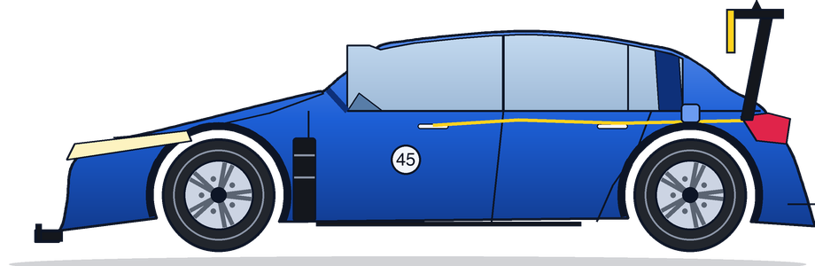
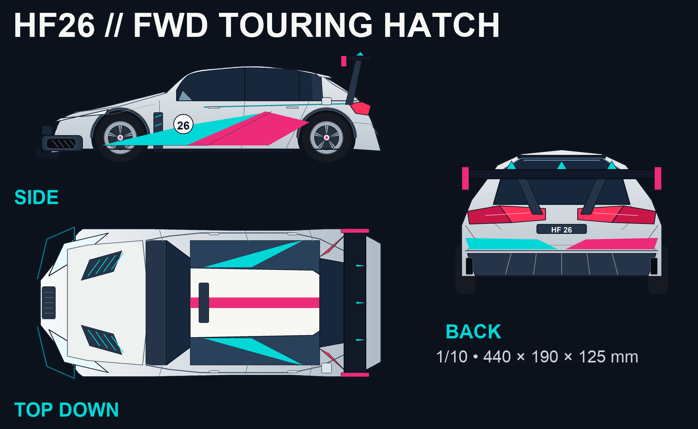
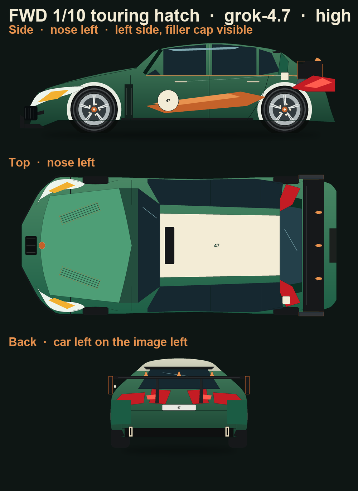

# Challenge-2 — 1/10 FWD touring-car body-shell sprites

**Type:** challenge  
**Event:** [Global Hack Week: Hacktoberfest](https://events.mlh.io/events/14553-global-hack-week-hacktoberfest)  
**Dashboard:** <https://ghw.mlh.io/challenges>  
**Geometry brief:** [`BASE_PROMPT.md`](BASE_PROMPT.md)  
**Reference art:** `schematics/tc_fwd_{side,top,back}.jpg` (Bittydesign CA45 painter sheets; local only)

Three agents each drew orthographic **side**, **top-down**, and **back** 2D sprites of a 1/10 FWD RC touring-hatch polycarbonate shell from the same station tables. Outputs live under `{llmModel}_{reasoning}/` so model settings stay visible in the path.

| Folder | Model | Reasoning | Agent session |
| --- | --- | --- | --- |
| [`muse-spark-1.3_high/`](muse-spark-1.3_high/) | Muse Spark 1.3 | high (strength 256) | [Muse Spark sprites](ca454222-660d-4a64-9b38-9f3c793371da) |
| [`gpt-5.6-sol_medium/`](gpt-5.6-sol_medium/) | GPT-5.6 Sol | medium | [GPT-5.6 Sol sprites](887a5c97-528e-40a9-98ff-df1ddb3a296a) |
| [`grok-4.7_high/`](grok-4.7_high/) | grok-4.7 | high | [grok-4.7 sprites](e7689c52-6f26-49bc-a382-2fe3acac3035) |

Sessions ran 2026-10-14 (Cursor agent transcripts, not committed).

---

## Shared prompt (all three sessions)

Near-identical user brief:

> Design three-perspective (top down, side, back) 2D sprites of a 1/10 scale RC touring-car body shell for the FWD class. `global-hack-week/challenge-2/BASE_PROMPT.md` describes the design in detail. Do not use any external skills but you can use known/existing libraries for sprite graphic design. Save results in `global-hack-week/challenge-2/{llmModel}_{reasoning}` from this session’s model settings.

Follow-ups (per session):

| Round | Muse Spark | GPT-5.6 Sol | grok-4.7 |
| --- | --- | --- | --- |
| 1 | Base brief | Base brief | Base brief |
| 2 | Allow vendoring a graphics library inside the working folder | — | Confirm output under `challenge-2/` |
| 3 | Improve against `schematics/` | Improve against `schematics/` | Improve against `schematics/` |

`BASE_PROMPT.md` is the geometry authority (L ≈ 440 mm, W = 190 mm, H ≈ 125 mm; station tables for side, plan, rear). The CA45 sheets in `schematics/` supply silhouette tells the tables leave soft: headlamp length, endplate height, splitter fence, louvre drawing, lamp wrap, wheel lip.

---

## Model settings used

| Entry | Model id | Reasoning | Other notes recorded in-session |
| --- | --- | --- | --- |
| Muse Spark | `muse-spark-1.3` | **high** (strength **256**) | First session; invented a stdlib PNG path before Pillow was allowed |
| GPT-5.6 Sol | `gpt-5.6-sol` | **medium** | Folder `gpt-5.6-sol_medium`; used challenge `.vendor` Pillow immediately |
| grok-4.7 | `grok-4.7` | **high** | Composer `modelConfig`: reasoning_effort `high`, context `500k`, fast `false`, maxMode true |

All three: **no external agent skills**; Pillow **12.3.0** for final rasters (Muse vendored under its own `.deps/`; the other two loaded `challenge-2/.vendor`).

---

## How each agent performed the task

### 1. Muse Spark 1.3 · high — [`muse-spark-1.3_high/`](muse-spark-1.3_high/)

**Approach.** Read `BASE_PROMPT.md` and the CA45 schematics early. Built a single reproducible `generate.py` that emits **SVG masters** (side / top / rear) plus PNGs. First pass was **Python stdlib only** (hand-rolled scanline + PNG encoder) because sandbox installs were blocked. Caught and fixed a rear-view **wheel axle-height** bug (wheels floated ~40 px; wing/fins clipped) before shipping docs.

**Round 2 — library upgrade.** After permission to vendor deps in-folder, installed Pillow 12.3.0 into `.deps/` (`pip install --target`), rewrote PNG path with **3× supersample + LANCZOS**, gradients, and real text; kept the stdlib renderer as fallback. Hit a Pillow `rect()` corner-order bug and normalized coordinates.

**Round 3 — schematics.** Side-by-side pass vs `schematics/*.jpg`: longer pointed headlamp to ~x=0.20, wrap-around tail lamp, splitter end fence, tall wing endplate, rim lip + lug dots, louvered wing vent, true parallelogram 4-slat bonnet vents, teardrop fins, door-shut ticks, swept pylons, diffuser strakes. Kept rear view **orthographic** even though the back sheet is 3/4 perspective.

**Deliverables.** `side/top/rear.svg` + `.png`, `generate.py`, `preview.html`, `requirements.txt`, README, MIT. Livery: racing blue, white roof/`45` roundels, yellow accents (CA45 nod).



### 2. GPT-5.6 Sol · medium — [`gpt-5.6-sol_medium/`](gpt-5.6-sol_medium/)

**Approach.** Shortest session of the three (two user turns). Immediately chose Pillow from the existing challenge `.vendor` tree, wrote `generate.py`, and produced transparent side / top / back PNGs plus a labeled **sprite-sheet**. Distinct **pearl-silver / cyan / magenta HF26** livery with race number `26` so the set would not collide with Muse’s blue/yellow.

**First pass.** Station-table geometry, presentation sheet with title and dimensions, dimension checks in-session. Iterated patches after inspecting the sheet (including font/label scaling on the composite).

**Schematic pass.** Read all three CA45 JPGs and folded blueprint cues into the generator while keeping prompt proportions: deeper rounded lower intake, brake-duct detail, fuel cap, roof lip, hatch/bumper seams, stronger shoulder channels, centre grille, hatch aperture, sculpted bumper shoulders, wider-swept pylons.

**Deliverables.** `side.png`, `top.png`, `back.png`, `sprite-sheet.png`, `generate.py`, README, MIT.



### 3. grok-4.7 · high — [`grok-4.7_high/`](grok-4.7_high/)

**Approach.** Confirmed model id / reasoning from session config before naming the folder. Drew with Pillow from `.vendor` in a **racing green / ivory / copper** livery, number `47`. First render failed on inverted box corners (`y1 must be >= y0`); fixed with normalized `box2`. Then used **pixel crops and colour probes** on the PNGs to tighten vents, wing fins (side view collapsed three Catmull fins into one overlapping lump — replaced with a single teardrop in elevation; three fins kept in top/back), and endplates.

**Path check.** User asked to confirm results under `challenge-2/`; already correct at `grok-4.7_high/`.

**Schematic pass.** Cropped cars out of the CA45 sheets into `_ref/` for comparison. Raised wing height and endplate drop to match the side sheet (taller than the prompt’s “~two wing thicknesses”), longer headlamp, splitter fence, wrap-around lamp, 4 louvres on 20° vents, arch-flare lines in plan, rim lip + five lug dots. Second fix after visual QA: endplate had covered wing chord; louvres had collapsed to squares — separated plate from plank and restored slanted slats. Pixel check: vent centre moves outward toward the tail (~38→53 mm off centreline), matching the 20° note.

**Deliverables.** `side.png`, `top.png`, `back.png`, `sprite-sheet.png`, `generate.py`, README, MIT (plus working `_ref` / `_crops` QA images).



---

## How the results improved

Across all three agents, quality climbed the same ladder: **station tables → render/debug → schematic detail**, with Muse adding an extra **stdlib → Pillow** rung.

| Stage | What improved |
| --- | --- |
| Geometry from `BASE_PROMPT.md` | Hatch stance, roof peak ~0.63 L, three-pane glass + thick C-pillar, flared arches, splitter/skirt, full-width wing on pylons with endplates + fins, slanted bonnet vents, one-side filler cap |
| Tooling / render QA | Anti-aliased edges (supersample), correct axle height / box orientation, readable race numbers, transparent game sprites + optional sprite sheet |
| CA45 schematic pass | Longer pointed headlamps, taller endplates, splitter fence, wrap-around lamps, true 4-slat louvres, shoulder/hatch seams, rim lip + lugs; orthographic back kept even when the photo is 3/4 |

**What differed between models (not ranked as “better,” just distinct):**

- **Muse Spark (high)** — only entry with SVG masters + HTML preview + local `.deps` Pillow; most explicit fallback story; blue/`45` CA45-flavoured livery.
- **GPT-5.6 Sol (medium)** — fastest path to a branded presentation sheet; strongest “HF26” graphic identity (cyan/magenta); schematic work emphasised intake, shoulders, and bumper sculpture.
- **grok-4.7 (high)** — heaviest quantitative self-check (crops, pixel probes on vents/endplates); green/copper/`47` set; documented trading prompt endplate height for the sheet’s taller plate.

Honest limits shared by every entry: wheels are **placement references**, not part of the shell; sprites are **concept graphics**, not manufacturing drawings or track-tested shells; no image-generation model was used — geometry is code-drawn with Pillow (and Muse’s SVG + stdlib fallback).

---

## Regenerate

```bash
python3 global-hack-week/challenge-2/muse-spark-1.3_high/generate.py
python3 global-hack-week/challenge-2/gpt-5.6-sol_medium/generate.py
python3 global-hack-week/challenge-2/grok-4.7_high/generate.py
```

Muse needs its `.deps/` (or falls back to stdlib). GPT and grok expect `challenge-2/.vendor` (Pillow 12.3.0).

## License

MIT per entry folder (`LICENSE` where present). Running decisions: [`docs/CHALLENGE-MEMORY.md`](docs/CHALLENGE-MEMORY.md).
