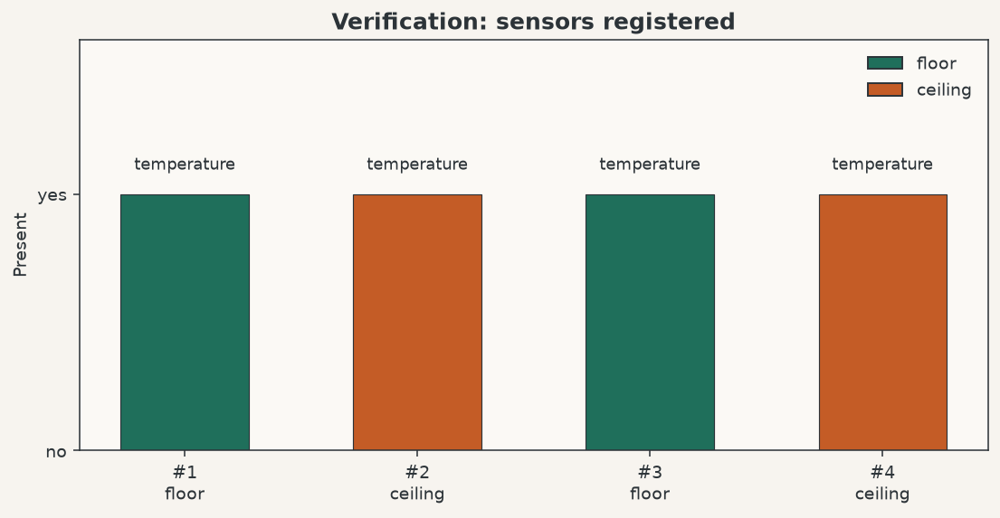
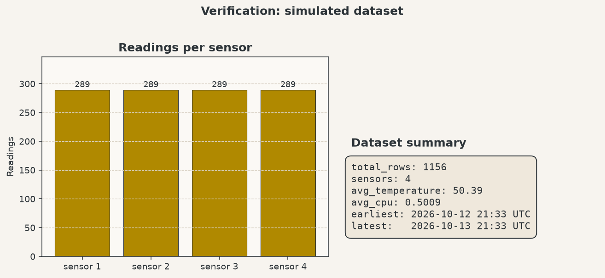
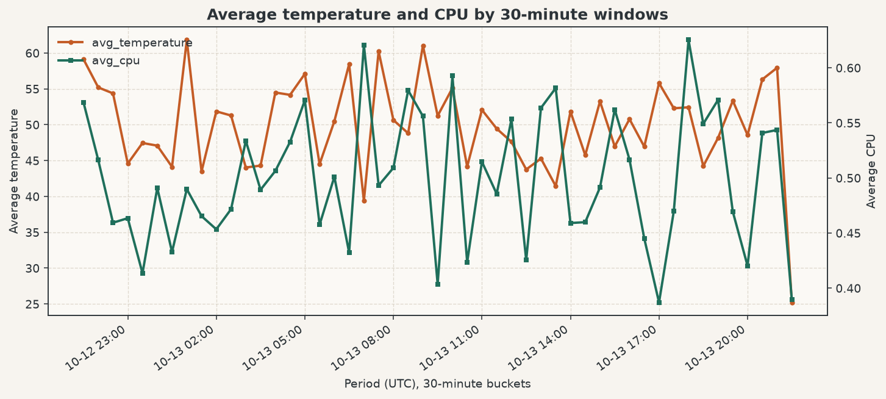
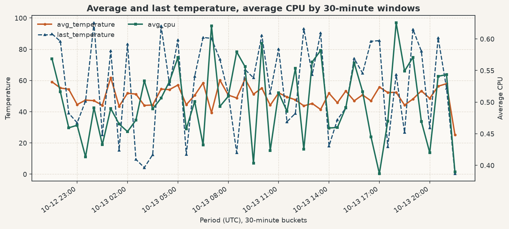
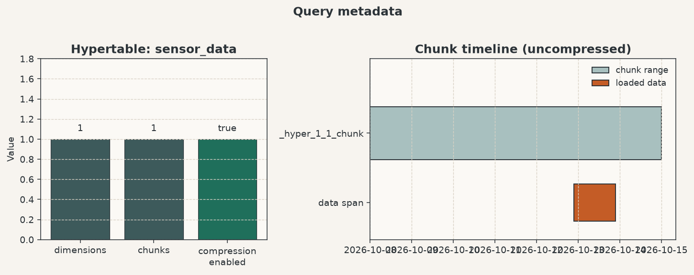

# Tiger Data: Simulate IoT Sensor Data

**Type:** hands-on session / tutorial  
**Service:** `tigerdata-demo` (`lpjy0yvp2m`, TimescaleDB, `us-east-1`, DEV)  
**Date run:** 2026-10-13

A short tutorial that creates sensor metadata and a TimescaleDB hypertable, loads 24 hours of simulated IoT readings, then runs time-bucket analytics and hypertable metadata queries.

## Folder layout

```
tiger_data/
  AGENTS.md                 Instructions for agents working in this folder
  README.md                 This file (intro, layout, queries, charts)
  docs/
    CHALLENGE-MEMORY.md     Running log of decisions and results
  sql/                      Schema DDL (run first)
    sensors_table.sql       Regular PostgreSQL table for sensor metadata
    sensordata_htable.sql   sensor_data hypertable (time, metrics, FK)
  migration/                Sample data (run after schema)
    sensors.sql             Four temperature sensors (floor / ceiling)
    sensordata.sql          24h of random readings every 5 minutes × 4 sensors
  viz/                      Charts for each returned query (PNG)
    01-sensors.png
    02-dataset-summary.png
    03-avg-temp-cpu-30m.png
    04-avg-last-temp-cpu-30m.png
    05-metadata.png
  scripts/
    generate_charts.py      Rebuild PNGs from the snapshot query results
```

## Deploy order

Against `tigerdata-demo` (`lpjy0yvp2m`):

1. `sql/sensors_table.sql`
2. `migration/sensors.sql`
3. `sql/sensordata_htable.sql`
4. `migration/sensordata.sql`

Via Tiger MCP `db_query` with `service_id` and `file`, or `tiger db query lpjy0yvp2m --file <path>`.

## What was deployed

| Object | Kind | Notes |
| --- | --- | --- |
| `sensors` | table | `id`, `type`, `location` |
| `sensor_data` | hypertable | `time`, `sensor_id`, `temperature`, `cpu`; compression enabled |

## Verification

### Sensors

```sql
SELECT id, type, location FROM sensors ORDER BY id;
```



### Simulated dataset

```sql
SELECT
  COUNT(*) AS total_rows,
  COUNT(DISTINCT sensor_id) AS sensors,
  MIN(time) AS earliest,
  MAX(time) AS latest,
  ROUND(AVG(temperature)::numeric, 2) AS avg_temperature,
  ROUND(AVG(cpu)::numeric, 4) AS avg_cpu
FROM sensor_data;
```



Expected shape: ~24h × 12 samples/hour × 4 sensors ≈ 1152 rows (endpoints of `generate_series` add a few more).

## Tutorial queries

Values are random (`random()` / `random()*100`), so re-running `migration/sensordata.sql` produces different numbers. Charts below are from the 2026-10-13 deploy.

### 1. Average temperature and CPU by 30-minute windows

```sql
SELECT
  time_bucket('30 minutes', time) AS period,
  ROUND(AVG(temperature)::numeric, 2) AS avg_temperature,
  ROUND(AVG(cpu)::numeric, 4) AS avg_cpu
FROM sensor_data
GROUP BY period
ORDER BY period;
```



### 2. Average and last temperature, average CPU by 30-minute windows

```sql
SELECT
  time_bucket('30 minutes', time) AS period,
  ROUND(AVG(temperature)::numeric, 2) AS avg_temperature,
  ROUND(last(temperature, time)::numeric, 2) AS last_temperature,
  ROUND(AVG(cpu)::numeric, 4) AS avg_cpu
FROM sensor_data
GROUP BY period
ORDER BY period;
```

Uses TimescaleDB `last(value, time)` for the most recent temperature in each bucket.



### 3. Query the metadata

```sql
SELECT
  hypertable_schema,
  hypertable_name,
  num_dimensions,
  num_chunks,
  compression_enabled,
  tablespaces
FROM timescaledb_information.hypertables
WHERE hypertable_name = 'sensor_data';

SELECT
  chunk_schema,
  chunk_name,
  range_start,
  range_end,
  is_compressed
FROM timescaledb_information.chunks
WHERE hypertable_name = 'sensor_data'
ORDER BY range_start;
```



## Notes

- `migration/sensors.sql` was empty in the starter files; it was filled with four `temperature` sensors so `sensordata.sql` (`sensor_id` 1–4) has valid foreign keys.
- Simulated metrics use SQL `random()`, so averages sit near ~50 for temperature and ~0.5 for CPU.
- Do not commit database passwords. Auth for Tiger MCP/CLI uses the local keyring after `tiger auth login` / `service_update_password`.
